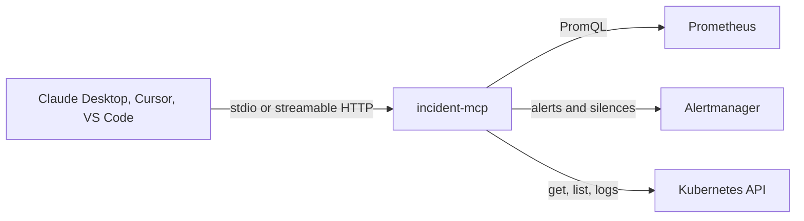

# incident-mcp

[](https://github.com/gaurangomkar/incident-mcp/actions/workflows/ci.yml)

incident-mcp is an MCP server that lets an assistant read Prometheus, Alertmanager, and Kubernetes while you are on call. It answers the first questions you would ask yourself: what is firing, is the deployment available, which pods are restarting, what do the events and the last log lines say.

It is read-only. It will not delete a pod, create a silence, or change a dashboard.

## Why this exists

On-call engineers are starting to keep an assistant open during an incident. The assistant can read a runbook and propose a PromQL query, but it cannot see the cluster unless someone pastes `kubectl` output and screenshots into the chat. That paste is slow, it goes stale, and it often includes more than the question needed.

MCP is the piece that was missing. A client such as Claude Desktop, Cursor, or VS Code can call tools over a standard protocol. incident-mcp is that tool surface for the three systems an SRE checks first, with the limits you would want before handing a production kubeconfig to a process an assistant can drive: a namespace allowlist, timeouts, truncated output, and best-effort redaction.

The assistant is still a junior on the bridge. It will misread a metric and it will sound confident. The server's job is to make the data it sees small, current, and hard to misuse.

## Features

- **Prometheus.** Instant and range PromQL. Series, sample, and range limits so one call cannot dump the whole TSDB into the context window.
- **Alertmanager.** Firing alerts, with silenced and inhibited alerts hidden unless you ask. Silences, filtered by state. No create and no expire.
- **Kubernetes.** Pods with ready count and restarts, recent events, a describe-style deployment summary, and pod logs with a tail and a line cap. Get, list, and logs only.
- **`triage_service`.** One deployment, one summary: availability, pods, warning events, matching alerts, a couple of Prometheus queries, and recent logs from the least healthy pod. A failed section is reported and the rest is still returned.
- **Stdio and streamable HTTP.** Stdio for desktop clients. HTTP for a remote client, with a required bearer token when the listen address is not loopback.
- **Config file and environment.** See [docs/configuration.md](docs/configuration.md).

## Architecture



A tool call is checked, sent upstream, redacted, and truncated before it comes back. The package map and the failure rules are in [docs/architecture.md](docs/architecture.md). Adding a tool is [docs/adding-a-tool.md](docs/adding-a-tool.md).

## Install

Go 1.27 or newer.

From a clone, which is also how you run unreleased commits:

```sh
git clone https://github.com/gaurangomkar/incident-mcp.git
cd incident-mcp
make build
./bin/incident-mcp -version
```

Once a release is tagged:

```sh
go install github.com/gaurangomkar/incident-mcp/cmd/incident-mcp@latest
```

Prebuilt archives for Linux, macOS, and Windows are attached to each GitHub release by GoReleaser. The same tag is pushed to `ghcr.io/gaurangomkar/incident-mcp`.

Container image, built locally:

```sh
docker build -t incident-mcp .
docker run --rm -i \
  -v "$PWD/examples/config.yaml:/config.yaml:ro" \
  -v "$HOME/.kube/config:/kube/config:ro" \
  -e KUBECONFIG=/kube/config \
  incident-mcp -config /config.yaml
```

Use `-i` and not `-t`. Stdout is the MCP protocol. Logs are on stderr. Mount a kubeconfig only if you are not using in-cluster config.

## Quickstart

Copy the example and point it at your cluster.

```sh
cp examples/config.yaml incident-mcp.yaml
# set prometheus.url, alertmanager.url, and kubernetes.allowed_namespaces
```

`incident-mcp.yaml` in the working directory is picked up automatically. You can also pass `-config`.

Give the process the RBAC in [examples/rbac.yaml](examples/rbac.yaml). It is get and list on pods, pod logs, events, and deployments. Do not grant Secret access. The server never asks for Secrets, and the RBAC should not offer them.

Then attach a client. The snippets below assume `incident-mcp` is on `PATH`.

### Claude Desktop

`~/Library/Application Support/Claude/claude_desktop_config.json` on macOS, or `%APPDATA%\Claude\claude_desktop_config.json` on Windows. A copy is in [examples/claude_desktop.json](examples/claude_desktop.json).

```json
{
  "mcpServers": {
    "incident": {
      "command": "incident-mcp",
      "args": ["-config", "/absolute/path/to/incident-mcp.yaml"]
    }
  }
}
```

Restart Claude Desktop after editing.

### Cursor

Project config is `.cursor/mcp.json`. User config is `~/.cursor/mcp.json`. See [examples/cursor.mcp.json](examples/cursor.mcp.json).

```json
{
  "mcpServers": {
    "incident": {
      "command": "incident-mcp",
      "args": ["-config", "/absolute/path/to/incident-mcp.yaml"]
    }
  }
}
```

For the HTTP transport, Cursor accepts a URL. Only do this on loopback, or with the bearer token set. The header form is:

```json
{
  "mcpServers": {
    "incident": {
      "url": "http://127.0.0.1:8080/mcp",
      "headers": {
        "Authorization": "Bearer ${env:INCIDENT_MCP_BEARER_TOKEN}"
      }
    }
  }
}
```

Start the server with `-transport http` before the client connects. `GET /healthz` returns `ok` and does not require the token.

### VS Code

Workspace config in `.vscode/mcp.json` uses the `servers` key. A portable `.mcp.json` uses `mcpServers` instead. See [examples/vscode.mcp.json](examples/vscode.mcp.json).

```json
{
  "servers": {
    "incident": {
      "type": "stdio",
      "command": "incident-mcp",
      "args": ["-config", "/absolute/path/to/incident-mcp.yaml"]
    }
  }
}
```

## Usage

These are prompts that map onto one tool. The server does not interpret the sentence. The client model chooses the tool. The descriptions on the tools are written so that it can.

**A page just fired for checkout in payments.**

> Triage payments/checkout. Tell me if the deployment is available, which pods are unhappy, and quote the alerts that match.

That is `triage_service` with `namespace=payments` and `service=checkout`. The summary starts with one line (`unhealthy`, `degraded`, `watch`, or `healthy`), then the deployment, pods, events, alerts, Prometheus, and logs from the worst pod. Logs are skipped when every pod is ready and nothing has restarted.

**What is paging right now?**

> List firing Alertmanager alerts with severity=critical. Leave silenced ones out.

`alertmanager_alerts` with matcher `severity=critical`. Silenced and inhibited alerts are omitted unless `include_silenced` or `include_inhibited` is set.

**Is this a bad deploy or a bad node?**

> Show pods in payments with label app=checkout, then the warning events for any pod that is not ready.

`k8s_pods` and `k8s_events`. Events take `involved_object` as `checkout-abc` or `Pod/checkout-abc`.

**The container already restarted. I need the crash, not the new process.**

> Read the previous logs for payments/checkout-7f8d, container app, last 80 lines.

`k8s_pod_logs` with `previous=true`. The tail is capped by `limits.max_log_lines`.

**Did the error rate move in the last hour?**

> Run a range query for `sum(rate(http_requests_total{namespace="payments",service="checkout",code=~"5.."}[5m]))` over the last hour.

`prometheus_query_range` with `lookback=1h`. If you omit `step`, the server picks one that stays inside `limits.max_prom_samples`. A range longer than `limits.max_range` (default 24h) is rejected. Use `prometheus_query` when you want the value at a single time.

**Who silenced this?**

> Show active silences.

`alertmanager_silences`. State defaults to `active`. The tool cannot create or expire a silence. Say so if the model offers to.

## Configuration

The full reference, including every environment variable and the validation limits, is [docs/configuration.md](docs/configuration.md). The short version:

- `timeout` bounds every tool call. Default 20s, maximum 2m.
- `limits.*` bounds how much comes back and how wide a PromQL range may be.
- `redact` scrubs secret-looking strings in tool output. It is on by default. It is not a guarantee. See [SECURITY.md](SECURITY.md).
- `kubernetes.allowed_namespaces` restricts every Kubernetes tool, including triage. Empty means every namespace, and the server logs a warning.
- `prometheus.url` and `alertmanager.url` are optional. Leave one empty and that section of triage says the backend is not configured.

Environment variables override the file. The ones you will actually set in a deployment are `PROMETHEUS_URL`, `ALERTMANAGER_URL`, `INCIDENT_MCP_KUBECONFIG`, `INCIDENT_MCP_ALLOWED_NAMESPACES`, and `INCIDENT_MCP_BEARER_TOKEN` when you use HTTP. `KUBECONFIG` works the same way it does for kubectl when `kubernetes.kubeconfig` is empty.

Flags: `-config`, `-transport`, `-http-addr`, `-version`.

## Security model

The process is built to be safe to run next to a production read credential, and no safer than that credential.

- There is no write path. The Kubernetes wrapper has get, list, and logs. Prometheus is queried. Alertmanager is listed. Tool hints are `readOnlyHint: true`, and a test fails if a registered tool drops that hint.
- Tool arguments cannot pick an upstream URL.
- The namespace allowlist is checked before the API call.
- Timeouts, series caps, log tails, and a byte cap keep one call from filling the context window or holding a huge response.
- Output and errors are redacted, then truncated. PEM keys, bearer tokens, JWTs, common GitHub, Slack, and AWS key shapes, URL userinfo, and `password=` style assignments are replaced. Env values whose names look sensitive are not printed in a deployment summary. A novel token format will get through.
- Stdio binds nothing. HTTP on a non-loopback address refuses to start without a bearer token. `/healthz` is open and returns a fixed string.
- Logs go to stderr and do not include tool arguments at info level.

Run it as a dedicated ServiceAccount with [examples/rbac.yaml](examples/rbac.yaml). Set the allowlist. Do not put this on a kubeconfig you would not hand to a new teammate.

More detail, including how to report a vulnerability, is in [SECURITY.md](SECURITY.md).

## Development

```sh
make test    # go test -race ./...
make lint    # golangci-lint, config in .golangci.yml
make ci      # vet, lint, test, build
```

CI on pull requests runs build, vet, lint, and test. See [CONTRIBUTING.md](CONTRIBUTING.md).

## Roadmap

The 0.1 surface is the first five minutes of an incident. Later, in roughly this order:

- Loki for logs that are not still on the pod, and Tempo or exemplars when a trace id shows up in a log line.
- A capped metric and label discovery tool, so the model can find a real metric name instead of guessing `http_requests_total`.
- Runbook and dashboard URLs pulled out of alert annotations and shown as themselves.
- More than one cluster in one process, each with its own allowlist.
- A Helm chart and a kube-rbac-proxy example for the HTTP transport.
- OAuth on the HTTP transport, once the MCP authorization spec is what the desktop clients implement.

Not planned: write tools. Silencing an alert or deleting a pod from the assistant is a different product and needs a different threat model.

## Good first issues

- `k8s_nodes`: node conditions and pressure, still read-only, no namespace.
- A `since` filter on `k8s_events` so a long-running namespace does not lead with yesterday.
- A Helm chart that installs the RBAC, the config, and the Deployment.
- A kind walkthrough that boots kube-prometheus-stack and runs `triage_service` against a broken sample app.
- A JSON output mode for callers that want structured fields instead of the text summary.
- Matcher filtering on `alertmanager_silences`, the same `key=value` shape alerts already take.

Open one before you start if you want a sanity check on the shape. The feature template asks for the incident question the change would answer.

## License

MIT. Copyright 2026 Gaurang Vishwasrao. See [LICENSE](LICENSE).
