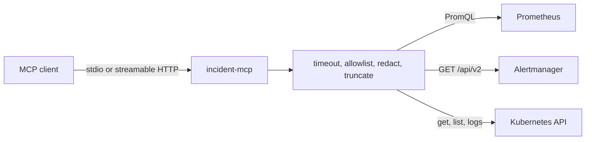
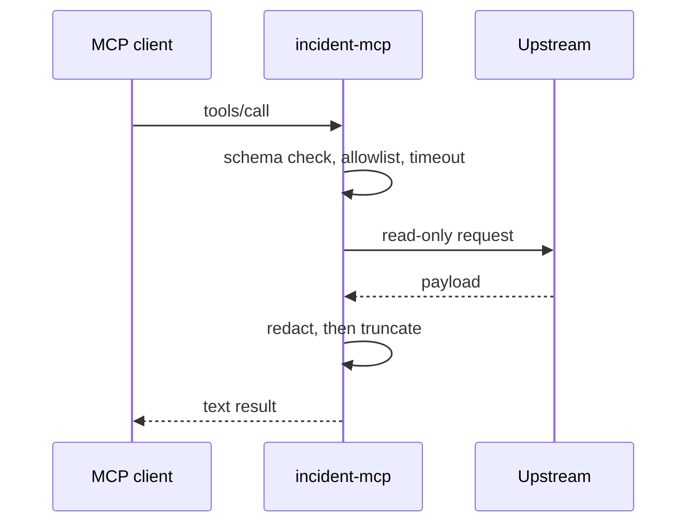

# Architecture

incident-mcp is a single process. An MCP client starts it over stdio, or connects to its streamable HTTP endpoint. Every tool call is a read against one of three upstreams, then a pass through the same output guard.

## Packages

| Package | Role |
| --- | --- |
| `cmd/incident-mcp` | Flags, config load, signal handling. Logs go to stderr so stdio stays clean. |
| `internal/config` | YAML file, environment overrides, validation. |
| `internal/server` | Builds the MCP server, registers tools, serves stdio or streamable HTTP. |
| `internal/mcptool` | Shared read-only annotations, timeout, redaction, and truncation. |
| `internal/prometheus` | Instant and range PromQL. `Querier` is the seam. |
| `internal/alertmanager` | Alerts and silences over API v2. `Client` is the seam. |
| `internal/kube` | Pods, events, deployments, logs. `NewClient` accepts any `kubernetes.Interface`. |
| `internal/triage` | `triage_service`. Calls the other three and keeps going when one of them fails. |
| `internal/upstream` | HTTP client with bearer token, token file, and basic auth. |
| `internal/redact` | Best-effort secret scrubbing. |
| `internal/output` | UTF-8 safe truncation. |

`internal/server.New` is the only place that knows about every tool. A new tool is a `Register` function called from there. See [adding a tool](adding-a-tool.md).

## What a tool is allowed to do

Kubernetes calls go through `kube.Client`. That type has list, get, and log methods. It does not wrap create, update, patch, or delete. The namespace allowlist is checked before the clientset is used, including when credentials are missing, so a denied namespace fails the same way whether or not the process can reach a cluster.

Prometheus and Alertmanager are reached only at the URLs in the config. Tool arguments do not accept a URL.

Tool errors are returned as MCP tool errors (`isError: true`) so the model can read them and try something narrower. A protocol error is reserved for a broken session.

## Output guard

`mcptool.Runtime.Call` does the same four things for every tool:

1. Apply the configured timeout.
2. Run the tool.
3. Redact the text, including error strings.
4. Truncate to `limits.max_output_bytes` on a rune boundary and append a marker.

Redaction runs before truncation so a secret cannot survive as a cut-off fragment at the end of the budget. The patterns are listed in [SECURITY.md](../SECURITY.md). They miss novel formats. Treat the output as visible to the model and to whatever retains the chat.

## Failure policy

`triage_service` is the exception to "one error fails the call". If the deployment itself cannot be read, the call fails. If events, alerts, Prometheus, or logs fail after that, the section says why and the rest of the summary is still returned. An incident is a bad time for an all-or-nothing report.
